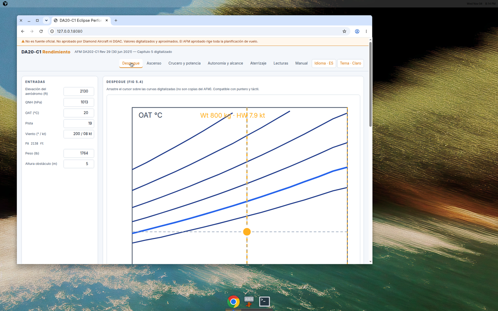
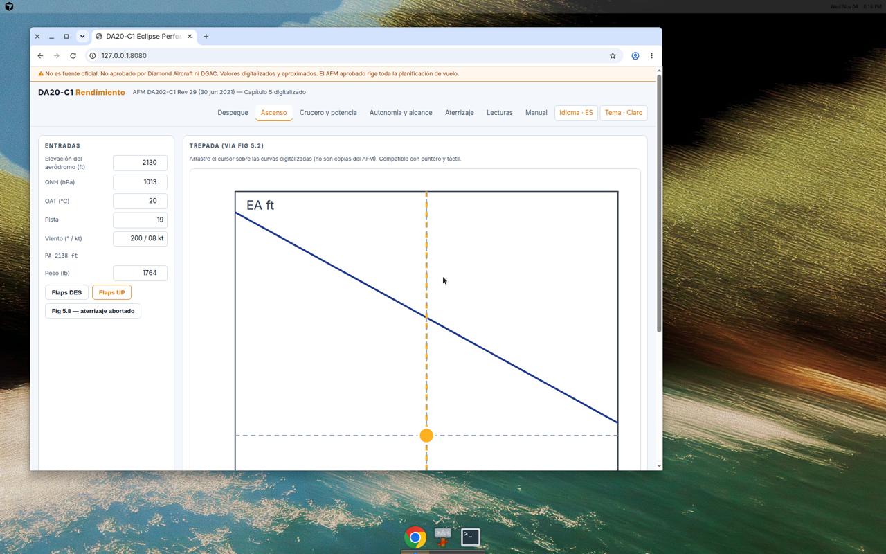
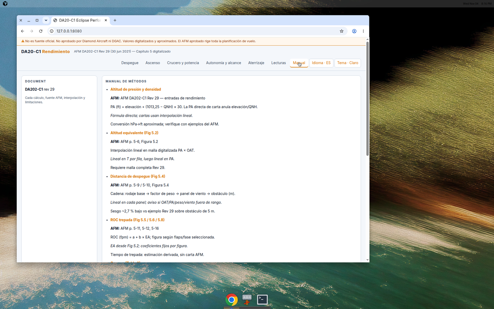

# Planificador de rendimiento DA20-C1 Eclipse

Versión en español del README principal. La interfaz usa **español por defecto** (conmutador EN).

## Fases (pestañas)

1. **Despegue** — Fig 5.4 + panel de viento Fig 5.3; entradas junto al gráfico interactivo.
2. **Ascenso** — Fig 5.5 / 5.6 / 5.8 según flaps (DES / UP / aborto).
3. **Crucero y potencia** — Tabla 3 (Fig 5.7 no digitalizada).
4. **Autonomía y alcance** — Derivado de Tabla 3, combustible utilizable AFM (Sec. 1) y reserva del usuario; **no es carta AFM**.
5. **Aterrizaje** — Tabla 4; sin corrección por viento, temperatura ni peso.
6. **Lecturas** — Historial local, CSV/JSON (`200 / 08 kt` en exportación).
7. **Manual** — Métodos y fuentes Rev 29.

## Tema

- **Claro por defecto** (fondo blanco, trazos oscuros, guía ámbar).
- Conmutador a **oscuro** (navy + ámbar, mockup aprobado); la elección se guarda en `localStorage`.

## Datos

- Producción: `data/da20c1_ch5_data_rev29.json` (AFM DA202-C1 Rev 29, cap. 5).
- No hay datos de **descenso** en Rev 29 → pestaña omitida.

## Despliegue

Host previsto: `da20-c1.heavenly.cl` detrás de **nginx-proxy** (`VIRTUAL_HOST` / `LETSENCRYPT_HOST`).

## Descargo

No es fuente oficial. No aprobado por Diamond Aircraft ni DGAC. El AFM aprobado rige toda la planificación.

## Capturas

