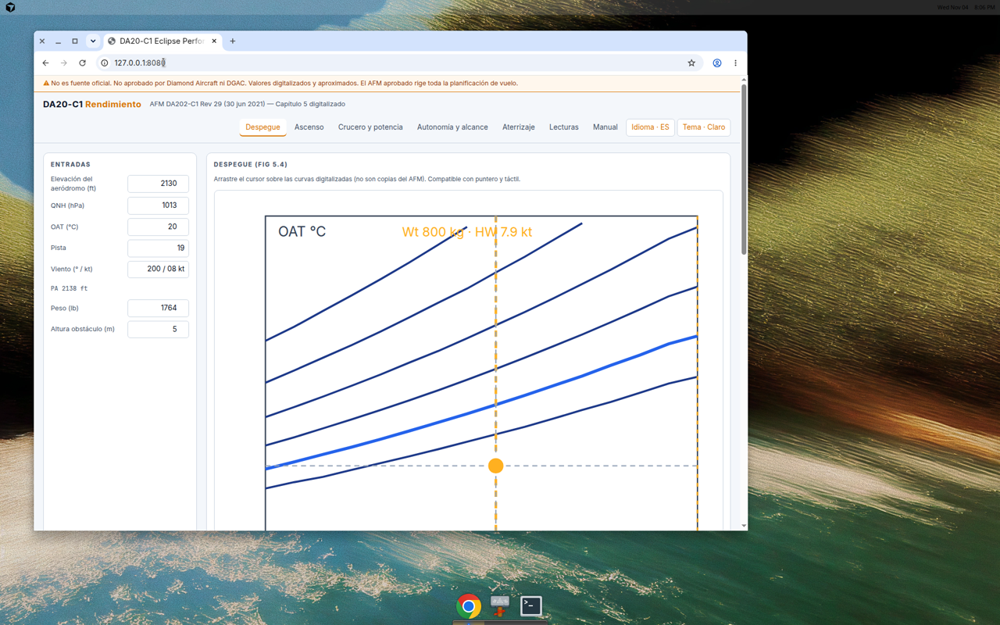
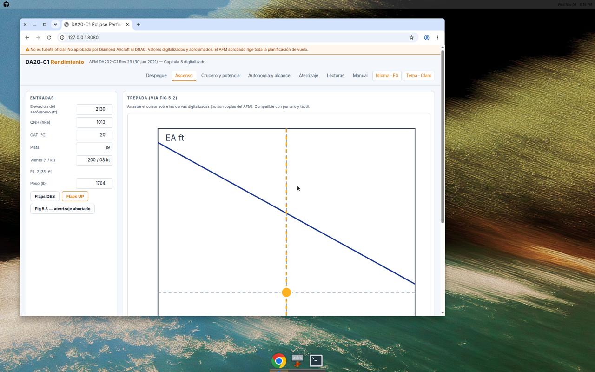
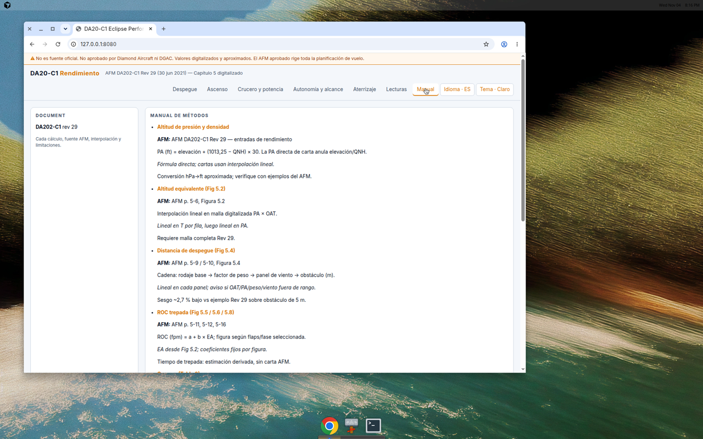

# DA20-C1 Eclipse Performance Planner

**Disclaimer:** This application is **not** an official Diamond Aircraft or DGAC-approved source. It is **not** approved for operational flight planning. Values come from digitized **AFM DA202-C1 Rev 29 (30 Jun 2021)** Chapter 5 data; interpolation and known digitization biases apply. The approved Aircraft Flight Manual (AFM) aboard the aircraft always governs.

Performance planning helper for the **Diamond DA20-C1 Eclipse**, implementing AFM **DA202-C1 Chapter 5**:

- Takeoff (Figure 5.4 — base × weight × wind panel × obstacle slope)
- Climb ROC (Figures 5.5 / 5.6 / 5.8 via Figure 5.2 equivalent altitude)
- Cruise (Table 3)
- Landing (Table 4)
- Wind components (Figure 5.3); takeoff/landing wind panels from Fig 5.4 sheet 1

## Stack

| Layer | Technology |
|-------|------------|
| Core | Rust (`da20-core`) — Rev 29 JSON model + interpolation |
| UI | Leptos → WASM (`da20-ui`) — phase tabs with inline inputs + interactive charts |
| Server | Single binary (`da20-performance`) — Axum, embedded `dist/` assets |
| Container | `scratch` static musl binary; `VIRTUAL_HOST` in `docker-compose.yml` |

**UI:** Spanish default (EN toggle, `localStorage`). Phase tabs: Takeoff, Climb, Cruise, Endurance, Landing, Readings, Manual — no Descent tab (Rev 29 has no descent data). **Light theme by default** (dark navy + amber toggle); choice saved in `localStorage`. Wind display: `200 / 08 kt`. See [README.es.md](README.es.md).

Intended host: `da20-c1.heavenly.cl` behind **nginx-proxy** (`VIRTUAL_HOST` / `LETSENCRYPT_HOST`), no bundled nginx.

## Data

| Path | Purpose |
|------|---------|
| `data/da20c1_ch5_data_rev29.json` | **Production** digitized AFM Ch.5 (Rev 29) with per-field `source` citations |
| `data/schema/performance-data.schema.json` | Legacy/generic schema (documentation) |
| `data/fixtures/SYNTHETIC_performance_data.json` | Retained for reference only — **not used at runtime** |

Official publications (Diamond partners portal):

- [Technical publications](https://partners.diamondaircraft.com/s/technical-publications)
- [AFM DA202-C1 Rev 29 PDF](https://partners.diamondaircraft.com/sfc/servlet.shepherd/document/download/069Tb000001DbNmIAK?operationContext=S1)
- [AMM DA201-C1 Rev 25 (2023-03-14)](https://partners.diamondaircraft.com/sfc/servlet.shepherd/document/download/069Tb000003HViPIAW?operationContext=S1)

## SCTB defaults

- Field elevation 2130 ft, QNH 1013 hPa, OAT 20 °C  
- Runway 19, wind 200° / 8 kt  
- Weight 1764 lb, cruise **6500 ft PA** @ 2600 RPM (Table 3 interpolated between 6000 and 8000 ft rows)  
- Obstacle height **5 m** (16 ft — AFM Fig 5.4 worked example)

## Validation

Rust tests port `validate_rev29.py` / `validation_rev29.txt`:

| Check | Tolerance | Notes |
|-------|-----------|--------|
| Wind components 11 kt @ 30° | ±0.1 kt | HW 9.5, XW 5.5 |
| ROC Fig 5.5 / 5.6 / 5.8 | ±1% | Via Fig 5.2 EA |
| Takeoff over 5 m obstacle (Rev 29 example) | raw ±1.5% vs ~1154 ft | **AFM conservative 1200 ft** (next 50 ft; m from ft) |
| Table 4 sea-level 50 ft distance | Exact | 1360 ft (≈415 m rounded; AFM text cites 414 m) |
| Table 3 GPH | As printed | Known oddities noted in UI |

**Gap:** Figure 5.7 cruise chart (65% / 121 kt example) is **not digitized** — Table 3 only.

Run: `cargo test -p da20-core`

**Fig 5.4 strip drag (manual, browser):** `svg` pointer handlers require a real DOM (`Element`, not `HtmlElement`). After building the UI, open **Takeoff** → drag on the strip: **OAT/PA panel** should change OAT and PA override; **weight panel** should change weight; **headwind panel** should change wind speed. The strip readout and numeric fields must update while dragging. Automated coverage: `cargo test -p da20-ui strip_drag_tests` (viewBox mapping and panel math only; no headless WASM DOM in CI).

### Screenshots

| Phase | Capture |
|-------|---------|
| Takeoff (Fig 5.4 strip) |  |
| Climb (Fig 5.2 → ROC strip) |  |
| Manual / methods |  |

## Build

```bash
rustup target add wasm32-unknown-unknown
cargo install trunk --locked
cd crates/da20-ui && trunk build --release
cd ../..
cargo run -p da20-server
```

## License

MIT — **Do not commit AFM/AMM PDFs or chart scans.**
